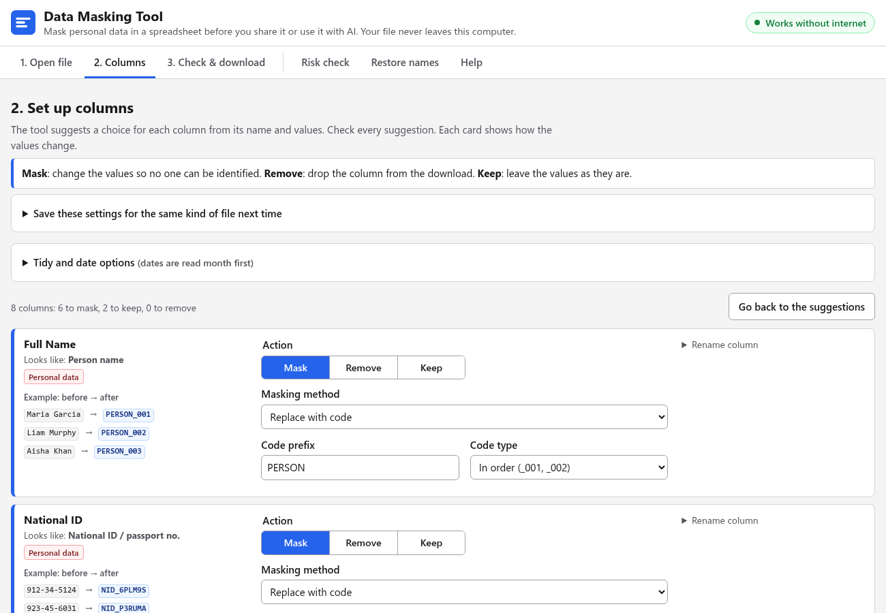

# Data Masking Tool

Hide personal data in a CSV or Excel file before you share it. It runs in your browser. Nothing is uploaded.



## Quick start

1. Open the hosted page, or download `index.html` from the [latest release](https://github.com/farhan-syah/data-masker/releases/latest) and open it in a browser.
2. Press **Try a sample file**, or choose your own CSV or Excel file.
3. Check each column. Download the masked data. Keep the match file private.

The page needs no install, no account and no internet. A Content-Security-Policy blocks every network request. The page cannot send your file anywhere, even from a web server.

## Read this first

The tool suggests. You decide. Check every column before you share anything.

| Limit | What you must do |
|---|---|
| It reads column names in English, French, Spanish, Portuguese, Italian, German, Dutch, Chinese, Japanese, Korean, Arabic, Russian, Hindi and Thai. | For other languages, check every column. |
| It finds names in notes only when the name is in a name column. | Read free-text columns yourself. |
| Month names work in English, French, Spanish, Portuguese, Italian, German, Dutch and Turkish. | For other languages, use number dates. |
| A mix of details can point to one person. | Count how many people share each mix. Merge groups of fewer than 5. |
| Masking does not change how your organisation classifies the file. | Follow your organisation's rules. |

## Browsers and files

| Item | Support |
|---|---|
| Browsers | Current Chrome, Edge and Firefox. Safari 16.4 or later. |
| Tested | Headless Chromium on Linux, macOS and Windows in CI. Firefox and Safari are not tested. |
| Files | CSV, TSV, TXT, `.xlsx`, `.xlsm`, `.xlsb`, `.xls`, `.ods`. |
| Text encoding | UTF-8 and UTF-16. For others, choose the encoding in step 1. |
| Dates | Day first or month first. The tool guesses. You can change it. |

## Steps

| Step | What you do |
|---|---|
| 1. Open your file | Choose a file, a sheet and the row with the column names. |
| 2. Choose what happens to each column | Choose **Mask**, **Remove** or **Keep**. Each card shows the result. |
| 3. Preview and download | Choose the rows. Read the preview. Download the files. |
| Risk check | Fix every red item. Read every yellow item. |
| Restore names | Turn codes in an AI answer back into real names. |

Share the least data you can. Column names only is safest. A masked sample is next. Totals you count yourself are also safe.

## Masking methods

| Method | What it does |
|---|---|
| Replace with a code | One code for each value, such as `PERSON_001`. The same value gets the same code. Numbers are in random order. Codes ignore capital letters. |
| Hide part of the value | Show a few characters. The rest become `*`. |
| Replace with a group or range | Date to year or age group. Number to range. Text to first letters. Address to its last part, such as the country. |
| Move dates | Each row moves by its own random number of days. Dates in one row stay the same distance apart. |
| Round or change numbers | Round, or add a small random change. |
| Replace with fixed text | Default `[REMOVED]`. |
| Hide names and numbers in notes | Names from name columns become codes. IDs, emails and phone numbers become `[ID NO]`, `[EMAIL]` and `[PHONE]`. |

## What the tool recognises

| Type | Header words and value patterns |
|---|---|
| Person name | `name`, `full name`, `surname`. Two or more capitalised words. |
| National ID | `national id`, `SSN`, `passport`. Values like `123-45-6789`. |
| Reference ID | `employee id`, `customer no`, `patient code`, `username`, `account`. Payment card numbers and IP addresses. Plain digit numbers of one length. |
| Age | `age`, `edad`, `年龄`. The tool groups ages in 5-year steps. |
| Email | `email`. Values with `@`. |
| Phone | `phone`, `mobile`. 7 to 15 digits with `+`, brackets, spaces, dots or dashes. |
| Address | `address`, `street`, `zip`. A street word or a postcode. Japanese, Chinese and Korean addresses keep the first area only. |
| Date | `date`, `dob`, `birth`. `25/12/2004`, `12/25/2004`, `2004-12-25`, `25 Dec 2004`, `12 janvier 1991`, `1991年9月12日`. |
| Money | `salary`, `amount`, `price`. `$1,250.00`, `EUR 900.50`, `1.234,56`. |
| Web address | `url`, `website`. The tool keeps the website and removes the path. |
| Free text | `notes`, `comments`, `message`. Long text, or short text with many words. |
| Location | `lat`, `lng`, `gps`. The tool rounds coordinates to about 11 km. |
| Private category | `diagnosis`, `religion`, `ethnicity`. The tool replaces values with codes. |

Other languages work when the values match these patterns. The tool puts a **Check this column** label on text it cannot classify. This includes Chinese and Arabic text, and columns where most values are different.

## Match file

The match file links each code to the real value. Anyone who has it can undo the masking.

- Keep it on your computer. Never upload it. Never send it to an AI tool.
- Do not open and save it in Excel. Excel changes long numbers and leading zeros.
- A dialog asks you to tick a box before it downloads.
- The page warns you before you close it with a masked download and no match file.
- The match file always fits the masked data you downloaded last. Both file names show the same four-character run ID.

Format: a CSV with the header `code,original_value,column`. Rows that start with `#` hold settings:

| Field | Value |
|---|---|
| `#warning`, `#source_file`, `#generated`, `#run_id` | Information |
| `#shift_mode` | `row` or `file` |
| `#shifted_date_columns` | Column names, separated by ` \| ` |
| `#date_order` | `dmy` or `mdy` |
| `#shift_days` | Days (file mode) |
| `#anchor_column` | The column that finds each row's shift (row mode) |
| `#shift` | One row's shift in days, and its anchor code |

## More limits

- Restore moves shifted dates back only in CSV and Excel files. In row mode, the file must keep the anchor column or the original row order.
- A first name found alone in a note becomes `[NAME]`. Restore cannot return it.
- A value that cannot be read becomes `[?]`. The page counts these.
- Thai dates in the Buddhist era (year + 543) give correct age groups. Other calendars, such as Hijri, are not converted.
- The tool does not calculate Excel formulas. It reads the saved values. Password-protected workbooks do not open.
- A masked or restored value that a spreadsheet could run as a formula gets a leading apostrophe. That means a value starting with `=` or `@`, or with `+` or `-` before a letter.
- Excel files from this tool have no cell styles.

## Build and test

You need Python 3 and Node.js 20 or later.

```sh
npm install
npx playwright install chromium
npm run build
npm test
```

| Item | Detail |
|---|---|
| `npm run build` | Runs `python3 build.py`. It joins `src/` and SheetJS into `index.html`. |
| Version | Set `DM_VERSION=1.2.3` to stamp a version. Without it, the page says "development build". Release tags set it. |
| `npm test` | Runs `tests/logic.test.mjs` (Node) and `tests/e2e.mjs` (one browser run). |
| What the browser test checks | No network request. No original value in any download. The match file fits the masked data. Restore returns the real values. |
| `CHROMIUM_PATH` | Set it to use a system browser. |
| `samples/` | Fictional data only. `python3 tests/make_samples.py samples` rebuilds it. It needs `openpyxl`. |

Commit the rebuilt `index.html` with every change to `src/`. Read `CONTRIBUTING.md` before you open a pull request.

## Third-party notice

The tool includes SheetJS Community Edition 0.20.3 (`xlsx.full.min.js`) under Apache-2.0. Source: https://cdn.sheetjs.com/xlsx-0.20.3/xlsx-0.20.3.tgz. The licence is in `vendor/sheetjs/LICENSE`.

## Licence

MIT. See `LICENSE`.
